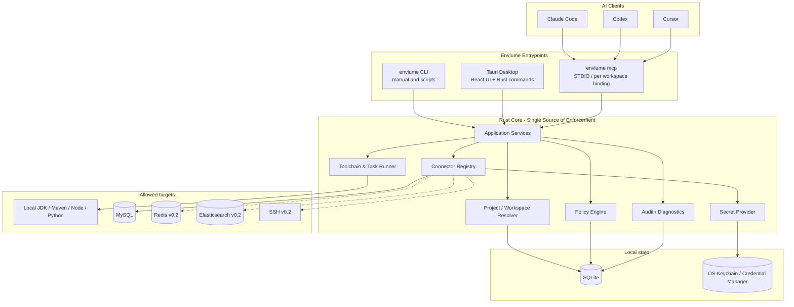
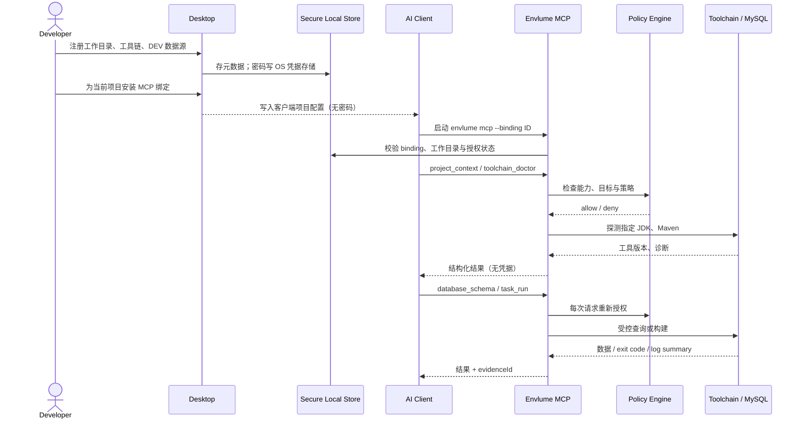
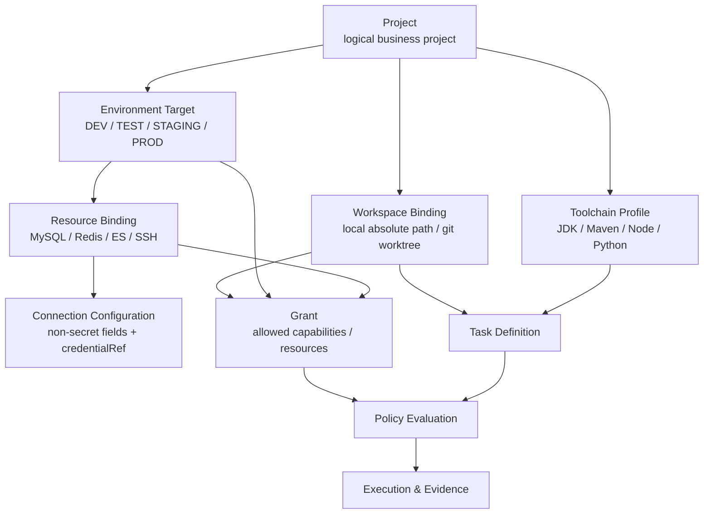
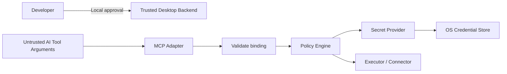

# Envlume — 系统架构与工程交付基线

> **AI-Native Development Environment Gateway**  
> *Your environment. Agent-ready.*
>
> **文档版本**：1.0.0（架构基线）  
> **状态**：Accepted / 作为初始实现的约束性基线  
> **制定日期**：2026-11-23  
> **适用平台**：macOS、Windows  
> **首个交付目标**：v0.1 MVP；本文同时定义 v0.2、v1.0 的扩展边界

---

## 0. 文档地位与使用方式

本文是 Envlume 的**架构决策源（Source of Truth）**，用于指导人类开发者、Codex、Claude Code、Cursor 及其他编码智能体。它规定产品目标、模块边界、风险约束、核心数据模型、工具接口、实现顺序和验收标准；不代表所有功能均已实现。

**规范用语**：

- **MUST / 必须**：违反即为架构偏离，PR 不得合入。
- **SHOULD / 应当**：原则上遵循；例外须记录理由。
- **MAY / 可选**：不影响基线的一种选择。
- 所有标记为 **v0.1** 的条款，是首版可验收范围；**v0.2 / v1.0** 为规划，不得在首版交付说明中声称已支持。
- 本文中的配置示例、CLI 和 JSON 仅定义**目标契约**，不是已经可运行的软件。

**实施规则**：先满足本文的跨模块不变量，再做具体功能。涉及运行形态、权限模型、密钥存储、资源绑定、接口兼容的更改必须提交 ADR（Architecture Decision Record），并同步更新本文；单个 Agent 不得擅自变更。

**推荐仓库放置**：

```text
envlume/
├── AGENTS.md                              # 短入口：要求读取本文、测试和约束
├── docs/
│   └── architecture/
│       ├── ARCHITECTURE.md               # 本文，唯一正式架构基线
│       └── adr/                          # 以后新增的架构决策记录
└── ...
```

`AGENTS.md`、`CLAUDE.md` 只能**引用**本文，不复制其全部内容。未来若文档分拆，本文仍保留完整的索引、关键约束、总体图、领域模型与验收准则。

---

## 1. 执行摘要（Executive Decision）

### 1.1 产品定义

Envlume 是一个**本地优先、项目隔离、默认安全的 AI 开发环境网关**：将每个代码项目需要的本机工具链、开发/测试/预演/生产资源、连接权限与验证任务组织为一个受控能力目录，并通过 **MCP + CLI** 向 AI 编程智能体和开发者提供一致的操作入口。

**必须解决的问题**不是“再造一个数据库客户端”，而是：

> 给定一个可信的当前项目，AI 能准确知道**有什么环境、哪些能力可用、如何安全调用、怎样产生可复核的执行证据**，避免手改全局环境变量、反复复制账号密码、误连错环境以及只写代码不验证。

### 1.2 最终技术路线

| 决策 | 选型 / 结论 | 理由 |
|---|---|---|
| 桌面应用 | **Tauri 2 + React + TypeScript + Vite** | 轻量跨平台桌面体验，界面与特权功能隔离 |
| UI 工具集 | **Tailwind CSS + shadcn/ui + Radix primitives + Lucide** | 可控、统一、现代而非堆砌后台组件 |
| 核心引擎 | **Rust + Tokio** | 原生执行、跨平台、强类型与连接器生态 |
| AI 主接口 | **MCP Server / STDIO** | 本地客户端直接唤起，兼容性与部署复杂度最佳 |
| 人类/脚本接口 | **独立 CLI：`envlume`** | 不要求桌面应用窗口常驻 |
| 主要 MCP SDK | **官方 Rust SDK：`rmcp`** | 对齐 MCP 标准，避免自行实现 JSON-RPC 协议 |
| 本地数据库 | **SQLite（`rusqlite`；WAL）** | 项目、绑定、环境、策略与审计元数据 |
| 凭据 | **macOS Keychain / Windows Credential Manager** | 数据库仅保存引用，不保存明文凭据 |
| 工具链 | **本机发现 + 用户指定路径 + 可选 mise 适配器** | 尊重企业离线环境，不强制下载和修改全局 PATH |
| MySQL | **Rust SQL 驱动（优先 `sqlx` 的 MySQL 支持）** | 结构化连接、连接池、异步及 TLS |
| Redis | **`redis` / redis-rs** | 原生连接，无需安装 `redis-cli` |
| Elasticsearch | **`reqwest` + 兼容版本适配层** | HTTP API 版本差异显式处理 |
| SSH（v0.2） | **`russh`** | 原生 SSH，主机密钥校验和命令约束 |
| 配置格式 | **本地 SQLite 为真实状态源；YAML 仅用于可分享的声明式模板** | 不把动态密钥和私有目标地址提交进 Git |
| 发布 | **macOS DMG；Windows NSIS EXE；独立 CLI** | 一次安装、按项目接入 AI |
| 许可证建议 | **Apache-2.0** | 适合开发工具及企业采用，发布前核对依赖许可证 |

首版**不强制**安装 Docker、mise、Node、Python、Java 或独立数据库客户端；但要执行真实构建，机器必须具备所需工具链，或用户明确授权安装。Envlume **检测、选择、调用**工具，不承诺“凭空提供”全部第三方运行环境。

### 1.3 不可妥协的架构不变量

1. **一切 MCP 调用都绑定一个已注册、已信任的本地工作目录 / Workspace Binding**；AI 传入的 `projectId`、`cwd`、`target` 不能重绑定身份。
2. **目标环境与本机工具链分离**。JDK 8 + Maven 3.8 可以访问 TEST 数据库，二者不是一回事。
3. **默认拒绝**：未知项目、未注册资源、未授予能力、生产写入、无 UI 审批的高风险动作一律拒绝。
4. **不把密钥放入模型上下文**。MCP 工具返回结构化结果而不是 MySQL URL、密码、SSH 私钥或完整连接配置。
5. **不修改用户系统级 `PATH` / `JAVA_HOME` / `MAVEN_HOME`**。执行时使用单次子进程环境覆盖，绝不污染父进程。
6. **MCP 不依赖桌面窗口开启**。安装后的独立 `envlume mcp` 可以按需启动；无云服务、无常驻 daemon 是 v0.1 默认形态。
7. **同一业务逻辑只有一份**。桌面、CLI、MCP 均调用同一 Rust application/core 层；不得实现三套权限判断。
8. **工具描述不是权限控制**；每次访问都由 Rust 端二次验证权限与资源参数，日志和返回结果须脱敏。
9. **首版 AI 接口只读访问基础设施**；数据库/Redis/ES 的通用写操作和 SSH 任意命令不在 v0.1。
10. **验证必须有证据**：运行目录、工具版本、目标环境、执行命令（非敏感摘要）、退出码、耗时、诊断和时间戳都应可追溯。
11. **不声称控制整个 Agent**。具备宿主机 Shell 权限的 AI 可能绕过 MCP，Envlume 只能保证**经自身网关**的访问受到治理。
12. **兼容性以实际客户端与真实目标环境测试为准**，不因 SDK 声称支持某协议版本就默认所有客户端已升级。

---

## 2. 用户、场景与范围

### 2.1 主要用户

- **企业全栈开发者**：Java/Spring、Vue/React、Node/TypeScript、Python、Rust 项目；使用多 JDK、Maven/Gradle、不同数据库实例。
- **AI Coding Agent**：Codex、Claude Code、Cursor 及支持 MCP 的客户端。
- **技术负责人 / 维护者**：希望检查环境配置、降低误连风险、审计操作结果。

**设计基准**：开发者在 macOS/Windows 上同时维护多个项目，每个项目至少 DEV、TEST、PROD，可选 STAGING；需要通过企业 VPN/内网访问 MySQL、Redis、Elasticsearch、Linux 等资源。

### 2.2 必须覆盖的用户故事

| ID | 故事 | 版本 |
|---|---|---|
| US-01 | 导入现有 Git 项目后自动识别项目工作目录与技术栈线索 | v0.1 |
| US-02 | 同时指定 JDK 8/17、Maven、Node/Python 的安装位置或版本约束 | v0.1 |
| US-03 | 一键诊断缺失、版本冲突、路径和构建环境，并给出修复建议 | v0.1 |
| US-04 | 为每个项目创建 DEV、TEST、STAGING、PROD 等目标环境 | v0.1 |
| US-05 | 每个目标下维护若干 MySQL 等资源的连接配置与凭据引用 | v0.1（MySQL） |
| US-06 | AI 无须知道密码即可查看开发库表结构、执行受控只读查询 | v0.1 |
| US-07 | AI 在指定工作目录运行授权的 Maven/Node 构建与测试任务 | v0.1 |
| US-08 | 一键把当前项目接入 Claude Code、Codex、Cursor | v0.1 |
| US-09 | AI 返回可核验的构建/查询/诊断记录，而不是仅凭推测宣称成功 | v0.1 |
| US-10 | 以相同方式读取 Redis 和 Elasticsearch | v0.2 |
| US-11 | 在受控主机上读取日志、做 SSH 连通性诊断 | v0.2 |
| US-12 | 为受限写操作引入显式审批、一次性授权与操作审计 | v0.2（可选功能旗标） |
| US-13 | 导入/导出非敏感项目清单、模板和团队共享策略 | v1.0 |
| US-14 | 受限网络代理、企业凭据 Broker 和扩展连接器 | v1.0+ |

### 2.3 明确不做（Non-goals）

- **不是** AI 模型客户端、代码编辑器、IDE 或另一个通用 Coding Agent。
- **不是** 替代 Navicat/RedisInsight/Kibana 的完整可视化运维产品；桌面 UI 首先为资源配置、诊断、授权而服务。
- **不是** 操作系统级安全沙箱，不对任意具有本机权限的进程提供绝对隔离。
- **不是** 企业级秘密管理服务、生产发布平台或云端多租户控制平面（首版）。
- **不自动接管**用户已有 `.env`、`.m2/settings.xml`、JDK 配置、代理设置或现有 AI 配置；只做受控发现与经确认的最小写入。
- **不支持**未经用户批准自动安装任意下载软件、自动切换 VPN 或静默改写生产资源。
- **不要求**任何第三方 MCP 网关/管理器作为基础依赖，避免将产品核心能力外包；允许借用协议 SDK 和驱动库。

---

## 3. 运行形态与总体架构

### 3.1 逻辑架构图



### 3.2 进程模型——明确选择“无 daemon 的独立多入口”

- **桌面进程**：`Envlume.app` / `Envlume.exe`，Tauri Rust 后端直接调用 `envlume-application` 服务层；WebView 只访问明确开放的 Tauri Commands。
- **CLI 进程**：`envlume doctor|project|integration|task|mcp`，与 GUI 共享 Rust crate，**不是**通过 GUI HTTP API 转发。
- **MCP 进程**：每个 AI 客户端按项目配置启动 `envlume mcp --binding <binding-id>`，`stdin/stdout` 用于协议，日志仅走 `stderr`/本地文件。
- **无后台常驻服务（v0.1）**：便于离线、轻量和 Windows/macOS 的快速安装；多个短命进程共享 SQLite，使用 WAL、事务和忙等待机制协调。
- **敏感写操作审批（v0.2）**：如需在 MCP 请求期间弹出本地 UI 审批，**先**引入经过身份验证的本地 Broker/IPC，不能临时使用未鉴权 localhost HTTP 端点。v0.1 直接不暴露此类操作。

> MCP 的 STDIO 进程**不是可信的会话身份**。MCP 2026-07-28 已按请求级语义演进，不应把 transport/session/cwd 误作授权身份；Envlume 使用独立的、经本地注册验证的 Workspace Binding。详见第 4、9 节。

### 3.3 端到端时序



---

## 4. 核心领域模型（Domain Model）

### 4.1 分层模型



### 4.2 实体及唯一职责

| 实体 | 字段 / 要点 | 不应承担的责任 |
|---|---|---|
| `Project` | 稳定 UUID、显示名、描述、状态 | 不保存明文密码、不承担某个本地路径身份 |
| `WorkspaceBinding` | UUID、projectId、规范化绝对路径、Git 信息、受信任状态、撤销时间 | 不以 Git remote URL 单独作为身份 |
| `ToolchainProfile` | projectId、组件与版本约束、检测路径、优先级 | 不等于 DEV/PROD 部署环境 |
| `EnvironmentTarget` | projectId、环境枚举/自定义名称、安全级别、是否默认 | 不包含本机 JDK 指定值 |
| `ResourceBinding` | targetId、类型、别名、主机/端口、TLS 选项、`credentialRef`、授权标签 | 不向 AI 回传凭据内容 |
| `TaskDefinition` | workspace/project、可执行文件、固定参数、工作目录、超时、输入策略 | 不接受模型任意 Shell 文本 |
| `CapabilityGrant` | bindingId、targetId、resourceId、能力、权限层级、状态/到期时间 | 不等于 AI 发起的用户确认 |
| `ExecutionRecord` | requestId、evidenceId、操作、脱敏参数摘要、结果、耗时、actor | 不持久化原始秘密和大规模查询结果 |
| `ClientIntegration` | clientType、bindingId、注册位置、配置指纹、安装状态 | 不代替实际授权 |

### 4.3 Project 与 Workspace 的区别

- 一个逻辑项目可以绑定多个 Git Worktree 或代码仓库路径；**每个本地路径必须独立建立 Workspace Binding**。
- `canonicalize`/路径存在性检查需要平台适配，避免符号链接、大小写别名、UNC、Windows Junction、路径穿越导致误绑定。
- 不允许因为两个目录具有相同的 Git remote URL 或相同目录名，就自动共享访问授权。
- 工作目录在导入后被移动、重命名、目标真实路径发生改变，应将绑定标记 `STALE` 并请求用户重新确认。
- Git 目录、`pom.xml`、`package.json` 仅作为**技术栈提示信息**；这些仓库文件可以被不可信代码修改，不能自动授予敏感权限。

### 4.4 环境等级

- 预设 `DEV`、`TEST`、`STAGING`、`PROD`，同时允许自定义名称（如 `UAT`、`GRAY`）。
- `environment.kind` 表示语义类别；`environment.riskLevel` 表示强制执行的风险等级（LOW/MEDIUM/HIGH/CRITICAL），不可通过重命名生产环境绕过。
- 目标环境属于某项目；资源再属于某目标；资源别名如 `primary-db` 可以在不同目标环境重复，但其实际连接和权限完全独立。
- 生产环境**不自动成为默认目标**。v0.1 MCP 操作涉及远端资源时必须显式指定已授权的 `target`（如 `dev`）；如果只有生产目标，也不能隐式选择。

### 4.5 不变量示例

- `Project` 删除默认软删除，并撤销其 Workspace Bindings 与 Grants。
- 删除 `ResourceBinding` 不应意外删除同一个 `credentialRef` 被其他资源合法引用的系统凭据。
- 同一 binding 重复执行连接配置安装必须幂等。
- 目标环境切换只改变选中的**远端资源上下文**，不修改本地 Java/Node 工具链配置。

---

## 5. 模块与目录结构（Monorepo）

```text
envlume/
├── apps/
│   └── desktop/
│       ├── src/                       # React + TS（只负责呈现）
│       │   ├── app/                   # router, bootstrapping, providers
│       │   ├── features/              # projects, targets, resources, toolchains, audit
│       │   ├── components/            # design system + shared UI
│       │   ├── services/              # Typed Tauri command clients
│       │   └── styles/
│       └── src-tauri/
│           ├── src/                   # Tauri commands, IPC validation
│           ├── capabilities/          # least-privilege permissions
│           ├── icons/
│           └── tauri.conf.json
├── crates/
│   ├── domain/                        # Pure domain models, policies vocabulary
│   ├── application/                   # Use cases, transactions, authorization points
│   ├── storage/                       # SQLite repositories + migrations
│   ├── secrets/                       # OS credential provider abstraction
│   ├── workspace/                     # Git/worktree discovery, canonical path
│   ├── toolchain/                     # Discovery, resolution, diagnostics
│   ├── execution/                     # Task runner / evidence / limits
│   ├── connectors/                    # Resource connector traits + registry
│   ├── connector-mysql/               # v0.1
│   ├── connector-redis/               # v0.2
│   ├── connector-elasticsearch/       # v0.2
│   ├── connector-ssh/                 # v0.2
│   ├── policy/                        # Policy evaluation (deny-by-default)
│   ├── audit/                         # Structured, redacted audit events
│   ├── mcp/                           # rmcp adapter + schemas
│   └── cli/                           # envlume binary, CLI + MCP process
├── integrations/
│   ├── clients/                       # codex, claude-code, cursor config adapters
│   └── skills/                        # optional Agent workflows
├── docs/
│   └── architecture/
│       ├── ARCHITECTURE.md            # 本文
│       └── adr/
├── tests/
│   ├── contracts/                     # MCP JSON Schema/golden tests
│   ├── integration/                    # MySQL containers, migrations, fake OS providers
│   ├── security/                       # Cross-project, traversal, denial cases
│   └── e2e/                            # Desktop and CLI smoke tests
├── .github/workflows/                 # fmt, clippy, test, audit, build, release
├── AGENTS.md
├── Cargo.toml                         # Rust workspace
├── Cargo.lock
├── package.json / pnpm-workspace.yaml  # Frontend workspace
├── pnpm-lock.yaml
├── LICENSE
├── README.md
├── SECURITY.md
└── .gitignore
```

### 5.1 依赖方向

```text
React UI -> Tauri Commands -> application -> domain
CLI/MCP ----------------------> application -> domain
application -> repository/secret/connector/toolchain traits
storage/secrets/connectors/execution -> implement traits
```

**强制约束**：`domain` 不依赖 Tauri、SQLite 或 MCP；`application` 不导入 React/CLI/Tauri 表现层；MCP 适配器只做协议解析、鉴权上下文获取和响应映射；连接器不能自行绕过应用层 Policy Engine。

### 5.2 Rust 关键接口（概念契约）

```rust
// 概念性伪代码，不保证可直接编译
pub struct RequestContext {
    pub binding_id: BindingId,   // 本地可信注册得出，不允许由 MCP tool 参数覆写
    pub client_kind: ClientKind,
    pub request_id: RequestId,
}

pub enum Capability {
    ProjectInspect,
    ToolchainInspect,
    TaskRun(TaskId),
    ResourceConnect(ResourceId),
    DatabaseMetadata(ResourceId),
    DatabaseRead(ResourceId),
    RedisInspect(ResourceId),
    ElasticsearchRead(ResourceId),
}

pub trait PolicyEvaluator {
    fn authorize(&self, ctx: &RequestContext, cap: &Capability)
        -> Result<AuthorizationDecision, PolicyError>;
}

pub trait ResourceConnector {
    fn kind(&self) -> ResourceKind;
    // connect/inspect/query 等由类型化能力 trait 提供，而非任意字符串执行
}
```

不得为方便开发引入 `execute_any_command`, `execute_any_sql`, `get_secret` 之类的通用后门。

---

## 6. 本机工具链管理（Toolchain）

### 6.1 基本策略

按优先级解析每个项目工具：

1. 项目绑定中**显式指定的可执行路径 / JDK Home**。
2. 项目级工具链锁定或已批准的 mise 配置（仅当用户选择启用）。
3. 项目原生约定：Maven Wrapper `mvnw`、Gradle Wrapper `gradlew`、`.nvmrc`、`packageManager`、`pyproject.toml` 等。
4. 系统可发现的已安装工具，需验证版本及路径。
5. 缺失时仅返回清晰诊断与建议，不自动联网安装。

**注意**：第 3 项中的 Wrapper 本身是仓库代码，执行前必须要求工作区为 `TRUSTED`；下载 Wrapper Distribution 需要按项目批准并展示 URL。`mvnw` 不能绕过权限与出站网络策略。

### 6.2 支持矩阵

| 工具 | 检测内容 | 首版 |
|---|---|---|
| JDK | `java`、`javac`、`JAVA_HOME`、版本、发行版、架构 | ✓ |
| Maven | `mvn` / `mvnw`、版本、settings 位置、与 JDK 对应 | ✓ |
| Gradle | `gradle` / `gradlew`、版本、JDK 绑定 | 基础识别，执行 v0.2 |
| Node | `node`、版本、项目约束 | ✓ |
| npm / pnpm / yarn | 版本与 lockfile，使用哪个包管理器 | ✓ |
| Python / uv | 版本、虚拟环境/解释器路径 | ✓ |
| Rust / Cargo | 版本与项目识别 | 基础识别 |
| Git | 版本、当前仓库、worktree 与 remote 提示 | ✓ |
| Docker / mise | 是否已安装、可选集成 | 检测 ✓；自动化集成后续 |

### 6.3 进程级环境覆盖

**不修改**系统或用户 Shell 的全局环境变量。执行引擎构造：

```text
ChildProcessEnv = SanitizedInheritedEnv
                  + SelectedToolchainEnv
                  + ExplicitNonSecretTaskEnv
                  - DisallowedCredentialVars
```

- Java 执行：设置本次 `JAVA_HOME`、将 `${JAVA_HOME}/bin` 添加到子进程 `PATH` 头部。
- Maven 3 使用所选 JDK 直接加载已解析发行版的 Classworlds 入口，Node 包管理器使用所选 Node 加载已解析的 JS 入口。选用仓库 Maven wrapper 时，先确认脚本和声明的分发地址。[ADR-0011](adr/ADR-0011.md)
- Node/Python 同理：使用明确解析出的可执行文件，不只信任 `PATH` 第一项。
- Maven `settings.xml` 可能包含仓库凭据，不回显其内容；检测只报告存在性、路径与敏感字段是否已安全配置。
- GUI 在 macOS 上可能无法继承终端 `PATH`；因此使用 OS 常见安装目录、用户路径与显式配置相结合的检测机制。
- Windows 使用 `PathBuf`/`Command`。已批准的仓库 `mvnw.cmd` 由系统 `cmd.exe` 在绑定根目录执行，启动参数全部采用固定字面量。

### 6.4 Task Runner 模型

首版仅运行用户明确启用的**具名任务**（例如 `maven-test`, `node-build`）；不开放 AI 自由 Shell 终端。

```yaml
# 示例：概念契约；首版由本地配置数据库管理
id: maven-test
displayName: Run Maven tests
workingDirectory: workspace-root
commandSource: resolved-toolchain
executable: mvn
arguments: ["-B", "-ntp", "test"]
timeoutSeconds: 600
networkPolicy: inherit-host-policy
needsWorkspaceTrust: true
approval: on-first-use
```

**重要安全事实**：即使限定为 `mvn test` 或 `npm test`，仓库的 `pom.xml`、npm scripts 也可以触发任意代码。此安全边界只用于防止 Agent 任意拼接命令，**并不提供恶意仓库沙箱**。首版必须对工作目录建立信任、对首次构建执行做明确提示，并确保构建子进程不继承存储的数据库/SSH 秘密。容器沙箱/进程权限隔离为后续独立能力。

---

## 7. 资源连接器架构（Connectors）

### 7.1 连接器契约

连接器按资源类型提供**类型化操作**，不接收无约束的命令字符串。连接步骤：

`resolve binding → resolve target → authorize → load credentialRef → establish TLS connection → execute constrained action → sanitize result → audit`。

所有连接器至少暴露：

- `test_connection`：连通性、认证及版本信息（不会返回密码）。
- `capabilities`：该实例允许的结构化操作清单。
- `health`：连接错误类别、网络/VPN 可达性提示、TLS 校验状态。
- `close`：及时释放连接和连接池资源。

连接器都必须限制 DNS/地址、TLS、超时、请求/响应体大小、并发数量和可选代理配置。默认禁止“把远端 URL 作为模型自由输入”形成 SSRF。

### 7.2 MySQL（v0.1）

- 存储：别名、host、port、数据库名、TLS 配置、`credentialRef`、环境等级、查询策略。
- 支持：`connection_test`、schema/table/column/index 元数据查询、单条受控 `SELECT`。
- 不提供：`INSERT/UPDATE/DELETE/DDL`、任意存储过程、`SELECT INTO OUTFILE`、多语句、任意管理命令。
- SQL 检查：MySQL 方言 AST 解析，只接受明确允许的语句类型；禁止危险函数/副作用构造；限制 schema/table allowlist；强制行数/字节数/超时上限。
- **最强保障来自数据库身份**：AI 使用单独只读账号或只读副本，结合数据库层 `GRANT SELECT` 等最小权限，而非仅用 SQL 正则拦截。
- 建议创建池时用每个资源独立配置，限制最大连接数和闲置时间；不要跨环境复用池或 credentialRef。
- 返回列级敏感信息前执行结果策略：只读≠可以泄露敏感个人/业务数据。首版默认仅供用户显式授权的 DEV/TEST 数据源；生产只读需要另行批准并启用列/表脱敏策略。

### 7.3 Redis（v0.2）

- 使用原生驱动连接 Redis/Valkey；支持鉴权、TLS、数据库编号、集群/Sentinel 按实际企业需求扩展。
- AI 仅提供 `PING`、`INFO` 的受限字段、`SCAN`（有分页上限）、授权 key 的只读 `GET/TYPE/TTL` 等能力。
- 避免 `KEYS *`、`MONITOR`、`CONFIG`、`FLUSH*`、Lua 脚本等高风险能力；`SCAN` 仍需大小/频率约束。
- 使用服务器 ACL 把账号限制在允许命令和 key pattern 内。

### 7.4 Elasticsearch（v0.2）

- 通过 HTTP(S) 官方 API 接口实现 `cluster health`、index metadata、mapping、受控 `_search`。
- 显式识别 ES 版本（7/8/9 等），建立最小支持矩阵；不同版本 API 差异不得默默吞掉。
- 限制 DSL 深度、索引白名单、结果数量、`_source` 字段、超时，默认只读；禁用脚本/更新/删除类 API。
- 认证采用 API key/基本认证凭据引用，不写入界面配置或日志；优先启用 TLS 证书验证。

### 7.5 SSH / Linux（v0.2）

- 首版不提供远程 Shell；v0.2 从**已批准主机 + 主机密钥固定/known_hosts 验证 + 只读日志任务**开始。
- 不支持默认执行 `sudo`、任意 Shell、无约束上传脚本、动态端口转发。
- SSH 私钥在系统安全存储或用户选择的文件路径；如需 passphrase，使用安全的本地交互；不将其暴露给 AI。
- 企业 VPN 是连接前置条件；Envlume 检测网络可达性与错误类型，不自行绕过公司访问控制。

---

## 8. MCP 接口契约（Agent-facing API）

### 8.1 传输与版本策略

- **v0.1 仅 STDIO**，AI 客户端负责启动并管理子进程。
- MCP `stdout` 必须只包含协议内容；日志/诊断写 `stderr` 或日志文件。
- 使用 `rmcp` 处理协议版本协商与旧客户端兼容；以 **MCP `2026-07-28`** 为当前设计参考，但必须对实际 Codex/Claude/Cursor 支持版本做回归验证。
- 不以连接、请求进程、对话、模型声称的项目路径作为身份/授权依据。显式绑定和每次策略评估是必需的。
- **不依赖**新版本已弃用的 `roots/list` 作为唯一项目发现手段；采用绑定注册表和 `project_context` 工具。
- v0.1 不开启 Streamable HTTP、公网监听或云服务。未来如果引入 HTTP，需单独 ADR 讨论 Origin 校验、OAuth/客户端身份、回环监听、CSRF、DNS rebinding 等。

### 8.2 工具集——v0.1

建议先暴露 **8 个** MCP tools，避免早期工具数量过多、混乱。

| Tool 名称 | 输入（简化） | 返回 | 权限 |
|---|---|---|---|
| `project_context` | `{}` | 项目、workspace、可见目标与能力摘要 | `project.inspect` |
| `environment_list` | `{}` | 可见环境及资源别名、健康状态，不返回密码/IP 等敏感信息 | `environment.inspect` |
| `toolchain_doctor` | `{ "profile": "default" }` | 工具版本、缺失项、有效路径摘要、修复建议 | `toolchain.inspect` |
| `task_list` | `{}` | 被授权的具名任务及默认超时 | `task.inspect` |
| `task_run` | `{ "taskId": "maven-test" }` | 任务执行结果、stdout/stderr 脱敏摘要、`evidenceId` | `task.run:<id>` |
| `connection_test` | `{ "target": "dev", "resource": "primary-db" }` | success/failure、延迟、错误类别、版本摘要 | `resource.connect:<id>` |
| `database_schema` | `{ "target": "dev", "resource": "primary-db", "table": "orders" }` | 表、列、索引的允许元数据 | `database.schema:<id>` |
| `database_query` | `{ "target": "dev", "resource": "primary-db", "sql": "SELECT ..." }` | 受限行列、脱敏数据、`evidenceId` | `database.read:<id>` |

`execution_report` 可以在 v0.1 作为 CLI/UI 的本地审计展示入口；若 AI 确实需要按 ID 查询历史证据，则以第 9 个 MCP tool 增加，须先评估其信息泄露面。Redis/ES/SSH 工具在对应 connector 的版本中再加入。

### 8.3 MCP 工具 Schema 原则

- 每个工具都有强 JSON Schema：`additionalProperties: false`、类型/枚举限制、必填字段、字符串长度、行数上限、无自由文件路径。
- 仅展示绑定内**已授予权限**的资源。注意：`tools/list` 的隐藏属于使用体验优化，不能代替执行期安全检查。
- 对模型返回明确的错误类别，例如 `PROJECT_NOT_TRUSTED`、`BINDING_REVOKED`、`TARGET_NOT_ALLOWED`、`POLICY_DENIED`、`TOOLCHAIN_MISSING`、`NETWORK_UNREACHABLE`、`CREDENTIAL_UNAVAILABLE`、`QUERY_NOT_ALLOWED`、`TIMEOUT`。
- 每次工具调用生成 `requestId`；可执行动作还生成 `evidenceId`，用于复核。
- 限制工具输出（默认查询最多 200 行、256 KiB 响应、5 秒数据库查询，首版仅作为默认建议值），调用方不能通过调大参数超过本地策略上限。
- SDK 提供的 MCP `readOnlyHint` 等注释不能作为安全判定来源；权限由 Envlume 自身执行。

**示例响应（非真实调用）**：

```json
{
  "ok": true,
  "requestId": "req_01...",
  "evidenceId": "ev_01...",
  "project": "order-service",
  "target": "dev",
  "operation": "database_schema",
  "durationMs": 132,
  "result": {
    "table": "orders",
    "columns": [
      {"name": "id", "type": "bigint", "nullable": false},
      {"name": "status", "type": "varchar(32)", "nullable": false}
    ]
  }
}
```

### 8.4 避免滥用 MCP Tools

- 不提供 `get_password`、`dump_all_databases`、`run_shell`、`execute_ssh_command`、`read_arbitrary_file`。
- 资源选择参数只能是已注册的逻辑别名，不接受由 Agent 指定 `host`、`port`、`connectionString` 或额外 headers。
- SQL 中若出现跨 schema 访问，必须先经允许列表校验；不能仅校验 `target = dev` 就任意连接所有开发服务器。
- 对模型及外部数据库返回的内容一律作为**不可信数据**处理，不能将查询结果中的指令作为新的系统策略。

---

## 9. Workspace Binding、鉴权与授权

### 9.1 信任边界



**三个绝不混淆的概念**：

1. **工作区信任（Trusted Workspace）**：用户认可这份代码的构建脚本可以在本机执行。
2. **资源授权（Capability Grant）**：允许这个工作区经 Envlume 访问哪些资源与哪些动作。
3. **MCP 客户端身份**：表示调用来自哪个本地集成入口；STDIO 并不自动证明模型、会话或具体用户身份。

### 9.2 绑定流程

1. 桌面/CLI 由用户选择现有本地目录；解析为规范化路径。
2. 检测 Git/worktree 元数据，仅展示信息，不自动授信。
3. 用户确认工作区信任；授予其**明确的项目、目标、资源、能力**集合。
4. 本地注册表分配随机且不可预测的 `bindingId`（不是密码，也不能单独当作鉴权强度证明）。
5. 集成适配器只把 `envlume mcp --binding <id>` 写入**匹配客户端的项目本地配置**。
6. MCP 进程启动时解析注册表、检查绑定状态/路径存在性/配置来源；每次工具调用重新检查 Grant 与 Resource。
7. 如果路径变更、项目被删、授权被撤销，则后续调用必须失败。

同一 OS 用户权限下的恶意本地进程可能读取配置和调用本地 CLI；**首版不声称对恶意同用户进程提供强隔离**。需要更强身份保障时，必须引入独立身份、受限 OS 账号、Broker/沙箱或远程授权体系，不可用一个 `bindingId` 假装身份认证。

### 9.3 默认权限矩阵

| 操作 | DEV | TEST | STAGING | PROD |
|---|---:|---:|---:|---:|
| 项目/工具链健康检查 | 允许 | 允许 | 允许 | 允许 |
| 资源健康检查 | 经资源绑定允许 | 同左 | 显式授权 | 默认禁用 |
| 数据库结构读取 | 授权后允许 | 授权后允许 | 显式授权 | 默认禁用 |
| 数据库只读查询 | 授权后允许 | 授权后允许 | 默认禁用 | 默认禁用 |
| 数据库 / Redis / ES 写入 | v0.1 禁止 | v0.1 禁止 | 禁止 | 禁止 |
| SSH 命令执行 | v0.1 禁止 | v0.1 禁止 | 禁止 | 禁止 |
| 本地已授权构建任务 | 按工作区授权 | 与目标无关 | 与目标无关 | 与目标无关 |

- 这里的“允许”仍以具体 Grant、资源 ACL 和用户确认的策略为前提，不是自动赋权。
- 更严格的用户自定义策略**只能收紧**基线；v0.1 不允许通过 UI 关闭 PROD 默认安全边界。

T09 对受信任工作区采用绑定级 grant，签发与分发使用同一矩阵。端点变更会撤销该资源的远端授权并解除旧凭据引用。现阶段 PROD 的独立只读审批与表/列脱敏尚未同时具备，远端入口拒绝 PROD 操作。[ADR-0012](adr/ADR-0012.md)

### 9.4 v0.2 高风险审批设计预留

审批记录至少包含 `intentHash`（动作+目标+资源+参数摘要）、`bindingId`、`expiresAt`、`oneTimeToken`、本地批准来源和用户可见摘要；执行前重新验证目标与参数未变化。MCP Server 不得自行判定“Agent 说已经获批”即为授权。无 UI / IPC 服务或过期则 `DENY`。**v0.1 不实现高风险写操作，也不提供伪审批按钮。**

---

## 10. 秘密、配置和数据持久化

### 10.1 数据分类

| 分类 | 举例 | 存放位置 | 是否可返还 AI |
|---|---|---|---|
| 公共元数据 | 项目别名、工具类型、任务展示名 | SQLite | 受策略允许 |
| 内部敏感元数据 | 主机 IP、数据库名、仓库本地路径 | SQLite（限制文件权限） | 默认只显示别名/摘要 |
| 高敏感凭据 | 密码、Token、SSH passphrase | OS Credential Store | **绝不返还** |
| 执行证据 | 工具版本、退出码、耗时、脱敏日志 | SQLite + 日志文件 | 授权后有限返还 |
| 仓库模板 | 工具版本要求、逻辑资源别名、非敏感策略建议 | 可选 `.envlume/project.yaml` | 可以 |

SQLite **默认不提供完整磁盘加密**。首版依赖 OS 用户权限、严格文件权限以及避免保存秘密；企业对内部网络地址也有加密要求时，须通过 ADR 引入 SQLCipher/安全数据封装或禁用该存储方式，不能声称默认“数据库已加密”。

### 10.2 建议存储路径

**macOS**：

```text
~/Library/Application Support/Envlume/
  data/envlume.db
  logs/
  backups/
  bin/              # 如采用用户级独立 CLI 安装
```

**Windows**：

```text
%LOCALAPPDATA%\Envlume\
  data\envlume.db
  logs\
  backups\
  bin\envlume.exe  # 如采用用户级独立 CLI 安装
```

通过平台目录 API 获取路径，不拼接固定用户名、盘符或假设 `~/` 一定可写。数据库目录、临时文件及日志不得设置为所有本机用户可读；Windows 使用用户 ACL，macOS 采用用户专用权限。

### 10.3 配置优先级

**执行时有效配置**：

```text
Built-in Defaults
  < Read-only Project Manifest Hints
  < User's Local Project/Resource Settings (SQLite)
  < User's Explicit Per-Run Non-secret Options
  constrained by Mandatory Security Policy (non-overridable)
```

用户的 CLI 参数可以更明确选择目标，但**不能扩大**未授予的权限。仓库清单永远不能包含对本地安全策略的强制授权请求。

推荐未来的共享模板（v1.0）只保留非敏感描述：

```yaml
# .envlume/project.yaml (未来版本，不代表 v0.1 已实现)
apiVersion: envlume.dev/v1
kind: ProjectManifest
metadata:
  name: order-service
toolchains:
  java: "8"
  maven: "3.8.x"
tasks:
  - id: maven-test
    kind: maven-test
environments:
  - alias: dev
    kind: DEV
  - alias: test
    kind: TEST
resources:
  - alias: primary-db
    kind: mysql
    environments: [dev, test]
# no host, username, password, secretRef or private path in shared manifest
```

主机/端口/账号字段是否随团队模板共享，应由未来的导出脱敏规则和企业策略决定。默认不共享。

### 10.4 最小 SQLite 表设计

```text
projects(id PK, name, description, status, created_at, updated_at)
workspace_bindings(id PK, project_id FK, canonical_path, trust_state,
                   git_fingerprint, status, created_at, revoked_at)
toolchain_profiles(id PK, project_id FK, name, rules_json, created_at)
environment_targets(id PK, project_id FK, alias, kind, risk_level, status)
resource_bindings(id PK, target_id FK, alias, kind, endpoint_json,
                  credential_ref, policy_json, status)
task_definitions(id PK, project_id FK, task_key, spec_json, enabled)
capability_grants(id PK, binding_id FK, target_id FK nullable,
                  resource_id FK nullable, capability, status, expires_at)
client_integrations(id PK, binding_id FK, client_kind,
                    config_location, config_fingerprint, status)
execution_records(id PK, request_id, binding_id, target_id nullable,
                  resource_id nullable, capability, decision,
                  redacted_summary_json, evidence_id, duration_ms, created_at)
schema_migrations(version PK, applied_at)
```

**要求**：UUID/ULID 统一格式、唯一约束、外键、字段长度校验、索引、UTC 时间戳、迁移事务、数据备份与升级回滚策略；大量原始 SQL 查询结果**不得**进入 `execution_records`。

### 10.5 SQLite 并发与升级

- 使用 WAL、`busy_timeout`、短事务，避免 MCP 多进程之间长时间持有写锁。
- schema 迁移由应用层迁移器负责；所有入口在发现新旧 schema 不兼容时**拒绝写入并提供升级诊断**。
- CLI/MCP 和桌面版本不一致时，需要兼容范围校验：不允许旧版本静默覆盖新结构。
- 升级前对本地数据库创建可恢复备份，凭据保留在系统安全存储；备份不包含明文凭据。
- 禁止在前端 WebView 持有数据库连接或 OS 密钥存储访问权限。

---

## 11. AI 客户端安装与项目接入

### 11.1 安装策略

- 桌面安装包同时包含独立 Rust CLI 的可执行产物；桌面关闭不影响 MCP。
- 安装/首次引导时将 CLI 安装到**稳定且受控**的位置（必要时复制到用户级 `bin`），并提示可选地加入 PATH；MCP 配置**优先写绝对路径**，因此无需强制修改系统 PATH。
- 如果选择 Tauri sidecar 机制打包 CLI，注意不同架构需要符合 Tauri `externalBin` 的 target triple 命名；从安装包内提取/定位版本化 CLI 的流程必须跨平台测试。
- 使用原子替换更新 CLI，避免运行中升级导致临时文件丢失；保留必要的回退版本。

### 11.2 各客户端的适配方式

| 客户端 | 首版集成位置 | 注意事项 |
|---|---|---|
| Claude Code | 优先项目本地 scope；可选仓库 `.mcp.json`（显式确认） | 团队共享与个人本地配置必须区分，不能往仓库提交绝对本地路径 |
| Codex | 可信项目 `.codex/config.toml` 或经确认的用户级配置 | 项目配置可能受 trust 机制影响；应探测当前版本支持情况 |
| Cursor | `.cursor/mcp.json`（项目级） | JSON 项目配置容易被提交，默认在安装向导中提示 `.gitignore` 或生成可移植模板 |

**不要**假定所有 IDE 对 MCP 项目作用域、配置热重载、交互批准的行为完全一样。集成适配器要有 `detect / preview / install / verify / uninstall` 五个操作，不用用户手工编辑文件。

### 11.3 配置写入保护

1. 检测客户端已安装及配置路径。
2. 预览即将增加或修改的**仅 Envlume 命名空间**。
3. 保存原配置备份；基于解析器保留未知字段和其他 MCP 服务配置。
4. 原子写入；发生语法错误或客户端拒绝加载时支持还原。
5. 先做无副作用 `project_context` 验证，再显示“已接入”。
6. 卸载仅删除自己记录的配置条目，不删除其他服务。

### 11.4 目标配置示例（不要直接当作实际安装文件）

**Claude Code / Cursor 的 STDIO 结构示意**：

```json
{
  "mcpServers": {
    "envlume": {
      "command": "/absolute/path/to/envlume",
      "args": ["mcp", "--binding", "binding_uuid"]
    }
  }
}
```

**Codex TOML 结构示意**：

```toml
[mcp_servers.envlume]
command = "/absolute/path/to/envlume"
args = ["mcp", "--binding", "binding_uuid"]
```

真实集成由适配器按 OS 路径和当前客户端配置格式生成，Windows 路径必须正确转义。上例的 `binding_uuid` 不是密钥，不应被当作强身份认证。

### 11.5 Skill 与提示词约束

- Skill **可选**，仅提供流程指导（诊断→查询→构建→验证），不能作为权限控制手段。
- `AGENTS.md`、`CLAUDE.md` 引用架构基线并告诉 Agent 在操作真实环境前先调用 `project_context`。
- 不写入“允许跳过审批”“总是执行生产修改”“输出秘密给用户”等无效或不安全规则。

---

## 12. CLI 命令规范

v0.1 目标 CLI：

```bash
envlume --version
envlume doctor                    # 本机整体诊断
envlume project add <path>        # 手工导入并触发信任确认
envlume project list
envlume project inspect --path <path>
envlume environment list --project <id>
envlume task list --binding <id>
envlume task run maven-test --binding <id>
envlume integration install codex --binding <id>
envlume integration install claude-code --binding <id>
envlume integration install cursor --binding <id>
envlume integration verify codex --binding <id>
envlume integration uninstall codex --binding <id>
envlume mcp --binding <id>
```

这里的 `project add` / `integration install` **不是强制通过无 UI 完成有风险的授权**。headless 情况下，涉及新工作区信任、首次任务执行或新增高风险资源时，应提供可审计的交互式确认，无法确认则拒绝。严格分离 `--json` 机器输出与人类可读文本，定义稳定退出码：`0 success`、`2 invalid input`、`3 policy denied`、`4 missing dependency`、`5 connection failure`、`6 timeout`、`7 internal error`（作为首版契约）。

### 12.1 输出格式

- 人类命令默认表格/状态显示；`--json` 只输出机器可解析的 JSON（含 `schemaVersion`）。
- `mcp` 模式 `stdout` 仅协议内容。
- 所有命令在 `stderr` 报错时也进行敏感信息清洗。
- 避免把平台私有路径、服务连接参数或 token 原样写进 CI 日志。

---

## 13. 桌面 UI/UX 架构

### 13.1 产品设计原则

目标是**专业、安静、信息密度适中、操作可预测的开发者工具**，而不是色彩堆叠的 AI 仪表盘。设计语言以层次、对齐、留白、状态与可读性为核心，优先支持深色主题和浅色主题，不依赖过度的发光、渐变、玻璃拟态或炫技动画。

采用 React + TypeScript + Tailwind + shadcn/ui/Radix + Lucide，建立语义 token（背景、前景、边框、交互状态、危险色）。**所有表单必须有键盘、焦点、错误提示和可访问性设计。**

### 13.2 核心信息架构

```text
Main Window
├── Overview        状态汇总、当前选中项目、诊断卡片
├── Projects        项目 / Git Worktree / Trust 状态
├── Environments    DEV / TEST / STAGING / PROD
├── Connections     资源类型、连接详情、测试、TLS 与凭据引用
├── Toolchains      JDK/Maven/Node/Python 检测与路径绑定
├── Integrations    Claude Code/Codex/Cursor 一键接入与验证
├── Activity        执行历史、验证证据与审计
└── Settings        外观、日志、安全、更新、诊断数据导出
```

推荐布局：左侧稳定导航 + 顶部项目切换器 + 主内容区；目标环境只在具体项目页选择，右上角清楚展示**当前目标风险级别**。在操作界面中不得用颜色作为环境唯一辨识依据，必须同时有文字（`DEV`、`PROD`）。

### 13.3 关键交互

- **首次启动**：欢迎 → 检测工具链 → 导入 Git 项目 → 配置 DEV 资源 → 授权 MCP 客户端 → 验证。可跳过未必需步骤。
- **导入项目**：自动发现 `pom.xml`/`package.json`，给出建议，**不自动安装或信任仓库脚本**。
- **添加连接**：选择项目/目标 → 类型 → 地址与 TLS → 将密码写入系统安全存储 → 测试 → 授权 AI 能力。
- **危险操作**：明确环境与资源，用户可辨识，不能靠一键切换无痕升级权限。
- **错误状态**：用户能区分未安装、版本不兼容、凭据缺失、VPN 不通、服务器拒绝与策略禁止。

### 13.4 Tauri 安全边界

- 前端不直接访问 SQLite、Keychain、执行 Shell、发起任意网络请求。
- Rust Tauri Commands 采用类型化输入/输出和能力校验；使用 Tauri capabilities 进行最小权限配置，不开放全局 shell 执行。
- 启用严格 CSP，避免加载第三方远程脚本；外部链接交给安全的系统浏览器。
- 高敏感凭据表单值通过一次性提交写入安全存储，前端不缓存、日志不记录、错误追踪不捕获。
- 对 UI 渲染的数据库/日志内容视为不可信文本，不执行任何 HTML/脚本。

---

## 14. 威胁模型与安全控制

### 14.1 受保护资产与攻击面

**资产**：本机开发目录、数据库凭据、SSH 密钥、企业内部地址、连接能力、项目源码、构建输出、审计记录。

**攻击面**：AI 工具参数、恶意仓库中的构建脚本、第三方依赖、MCP 配置文件、资源响应中的 prompt injection、跨项目绑定混淆、本地 SQLite 竞争、URI/路径穿越、浏览器 WebView/IPC、结果日志泄露、Windows/macOS 配置差异。

### 14.2 威胁与强制缓解

| 威胁 | 例子 | 缓解要求 |
|---|---|---|
| 横向越权 | A 项目 AI 访问 B 的 MySQL | 每次按 binding + target + resource + grant 校验；负面测试 |
| 环境混淆 | `dev` 被恶意配置指向 PROD | endpoint 经用户批准绑定；资源 riskLevel 不由名称推断 |
| 密钥泄漏 | 模型请求“把密码发给我” | 无 `get_secret` 工具；系统安全存储；统一脱敏 |
| Prompt injection | DB 字段包含“执行删除命令” | 外部数据仅作为数据，不提升权限或修改工作流 |
| 任意代码执行 | AI 自由传 Shell，或 `npm test` 中恶意脚本 | MCP 仅具名任务；可信工作区；构建无凭据；安全边界说明 |
| SQL 越权/副作用 | `SELECT INTO OUTFILE`、跨库查询 | AST allowlist + DB 只读身份 + 表/列白名单 + 限流 |
| SSRF | 将资源 host 改为内网元数据地址 | 仅本地注册端点；禁止 AI 任意网络地址；解析后 IP 校验 |
| 本地 IPC 冒用 | 恶意网页调用 localhost 管理端口 | v0.1 无管理 HTTP；v0.2 需独立鉴权与 Origin 校验 |
| 配置文件破坏 | 自动安装 MCP 覆盖用户配置 | 备份、合并、原子写入、验证、回滚 |
| 凭据作用域外泄 | Maven 子进程继承 DB 密码 | 构建 env 白名单；秘密仅连接器直接取用 |
| 审计泄露 | SQL 结果/敏感日志持久化 | 摘要、敏感字段脱敏、限量保留、用户清理 |
| 路径欺骗 | symlink/junction 指向另一个项目 | 路径规范化、绑定指纹、迁移失效重授权 |

### 14.3 强制安全测试

最少包括：`SEC-001` 未绑定项目拒绝；`SEC-002` binding 被撤销拒绝；`SEC-003` 非授权 target 拒绝；`SEC-004` 禁止 PROD 写入；`SEC-005` MCP 无 secret getter；`SEC-006` SQL 多语句/危险函数拒绝；`SEC-007` 跨库/越界表访问拒绝；`SEC-008` 路径穿越与 symlink 替换失败；`SEC-009` 日志不含密码；`SEC-010` MCP stdout 不受日志污染；`SEC-011` 集成文件回滚不破坏第三方配置；`SEC-012` 未信任仓库无法执行任务。

### 14.4 必须坦诚告知用户的限制

- Envlume 不提升网络权限：企业 VPN/防火墙禁止的连接不会被绕过。
- 系统凭据存储是安全改进，但对已入侵的同 OS 用户会话、恶意软件并非绝对防护。
- 具备文件/终端权限的 AI 客户端仍可使用自身能力直接访问工作区或系统资源；Envlume 的 Policy 不控制这些外部通道。
- 跑测试就是运行仓库代码；安全信任必须明确，不能因为操作名叫 `test` 就视为无副作用。
- 数据库“只读账号”也可能读到敏感数据，因此还需要表级/列级最小权限和结果过滤。

---

## 15. 错误、诊断、可观测性与验证证据

### 15.1 统一操作结果

执行结果建议包含：`schemaVersion`、`requestId`、`evidenceId?`、`timestampUtc`、`bindingAlias`、`targetAlias?`、`capability`、`status`、`durationMs`、`errorCode?`、`summary`、`sanitizedDetails`。

不需要把每个资源的原始返回体写进审计数据库。执行记录和用户可查看的详细报告要有保留期限、删除能力和输出大小控制。

### 15.2 诊断层次

```text
L1 — Host        OS/架构、文件权限、CLI 安装状态
L2 — Toolchain   JDK/Node/Maven/版本与路径
L3 — Workspace   Git 根、工作区信任、具名任务
L4 — Network     DNS/TCP/TLS/企业 VPN 前置条件
L5 — Service     MySQL/Redis/ES 鉴权、版本、可用性
L6 — Policy      当前 binding/target/resource 能力
L7 — Workflow    编译、测试、结构查询、验证结果
```

**失效报告必须可行动**：例如“JDK 8 未找到，找到 JDK 17（路径已脱敏），项目要求 8；请选择已有 JDK 8 路径或安装后刷新”，而不是只有 `failed`。

### 15.3 验证证明定义

`evidenceId` 关联到：实际执行的解析后工具版本、任务 ID、目标项目/工作区、时间、退出码、日志摘要（脱敏）、断言/测试结果、关联目标资源和操作者上下文。**不把模型自述当验证证据**。UI 用状态（Success / Failed / Denied / Skipped）呈现，允许复制脱敏结果。

---

## 16. 平台、发布、升级和供应链

### 16.1 支持平台

| 平台 | MVP 目标 | 交付物 |
|---|---|---|
| macOS Apple Silicon | 必须 | `.dmg` + CLI |
| macOS Intel | 必须（CI 验证与按需真实机器验收） | `.dmg` + CLI |
| Windows 11 x64 | 必须 | NSIS `-setup.exe` + CLI |
| Windows 10 x64 | 尽力兼容；仅在客户 OS 支持/安全策略允许前提下测试 | 同上 |
| Windows arm64 | 后续 | 规划 |
| Linux | 不在正式桌面首版范围 | 后续 |

Windows 依赖操作系统 WebView2 运行时；安装器必须检测缺失并给予可解释处理。macOS 公共发行应使用 Developer ID 签名及 Apple notarization；Windows 公共发行建议签名。开发版未签名不等于正式发行达标。

### 16.2 打包规则

- 桌面使用 Tauri 2 的正式构建能力，分别生成 macOS DMG 和 Windows NSIS EXE。
- CLI 是**独立可执行文件**，与桌面共享核心 crate；用固定版本号兼容校验，不能因桌面退出而停止工作。
- 构建产物必须绑定目标架构（Apple Silicon / Intel / Win x64）；不能只在开发机通过就视为跨平台可用。
- 启动后定期或手动检查更新，但**首版不得强制联网**；离线功能必须可用。
- 更新前备份元数据；迁移失败自动回滚或进入只读恢复状态，绝不丢弃用户的资源映射。

### 16.3 CI 与安全质量门

1. Rust `cargo fmt --check`、`cargo clippy`（建议 deny warnings）、`cargo test`。
2. 前端 `pnpm install --frozen-lockfile`、lint、TypeScript typecheck、unit test、生产构建。
3. 安全与许可：`cargo audit`、依赖许可证扫描、锁文件一致性与秘密扫描。
4. 契约测试：MCP JSON Schema、STDIO stdout 清洁、CLI `--json`、SQLite 迁移兼容。
5. Linux CI 可用于 Rust 单元测试，但**不能替代** macOS/Windows 原生执行测试。
6. macOS arm64/x64、Windows x64 安装/卸载/升级 Smoke test；使用干净用户环境验证。
7. GitHub Releases 输出带 SHA-256 校验值、变更说明、版本号及安全注意事项。

**依赖版本策略**：不要在本文硬编码随时过期的所有 crate 精确版本。实现时由 `Cargo.lock`、`pnpm-lock.yaml` 锁定可复现构建，并在相关 ADR 中记录影响架构的版本升级。

---

## 17. 非功能要求（验收目标，不是已实现承诺）

| 指标 | 初始目标 / 方法 |
|---|---|
| 本地优先 | 无互联网也能导入项目、查看本地配置、检测已有工具；连接内网须有 VPN/路由 |
| 用户体验 | 桌面主界面首次可交互尽量 ≤ 3 秒（冷启动性能在目标硬件测量） |
| MCP 可靠性 | 初始化/发现和单次工具调用错误可诊断；stdout 协议零污染 |
| 诊断性能 | 已安装工具的本地基本检测通常 ≤ 5 秒；远程网络诊断独立超时 |
| 资源查询 | 默认数据库超时 5 秒，≤ 200 行、≤ 256 KiB 响应；安全配置可收紧 |
| 任务执行 | 按 task 配置超时及取消；子进程退出后资源释放，避免僵尸进程 |
| 并发 | 首版限制 MCP 并发任务/连接池规模，SQLite WAL 短事务 |
| 安全性 | 12 项强制负面安全用例全通过；真实凭据从不进入模型上下文 |
| 兼容性 | Codex、Claude Code、Cursor 至少各完成一次端到端 POC |
| 可恢复性 | 配置写入失败可回滚；schema 升级前备份；凭据引用损坏有修复向导 |
| 可观测性 | 所有受控执行具 requestId；操作错误分类明确，证据可追溯 |
| 可维护性 | domain/application 层不包含 Tauri/MCP/SQLite 细节；适配层可测试替换 |

这些是工程预算，完成 v0.1 后用基准测试与实际机器结果修订，而不是以未经测试的数字对外宣传。

---

## 18. 实施里程碑、依赖与禁止跨阶段实现

### Phase 0 — 架构骨架与契约冻结

**交付**：Rust Workspace、Tauri React Shell、CLI、SQLite 迁移机制、核心实体、CI、测试基架、ADR 模板、安全威胁模型。

**验收**：桌面和 CLI 读取同一项目数据；MCP 能通过 STDIO 响应 `project_context` 的模拟数据；3 个平台目标至少编译通过；单元测试稳定。

### Phase 1 — 项目与工具链闭环

**交付**：Project/Workspace Binding、受信任状态、JDK/Maven/Node/Python 检测、独立子进程 env、具名 `maven-test` 任务、诊断和证据。

**验收**：同机有 JDK 8 和 17 时，一个 Java 8 项目明确选中 8 并运行 Maven 测试；系统 `JAVA_HOME` 无变化；未信任仓库被拒绝执行。

### Phase 2 — 环境与 MySQL 闭环

**交付**：DEV/TEST/PROD 目标、MySQL 资源、OS 凭据存储、连接检测、表结构、只读查询、策略和审计。

**验收**：同项目 DEV 与 TEST 连接互不污染；A 项目不能访问 B 项目；PROD 默认拒绝；明文凭据不出现在日志、SQLite、MCP 响应中。

### Phase 3 — AI 集成与桌面完成（v0.1）

**交付**：Claude Code/Codex/Cursor 配置适配器，一键注册/验证/卸载、UI 全流程、安装包、跨平台集成测试、首次使用引导。

**验收**：新用户安装桌面 → 导入 Java 项目 → 检查 JDK/Maven → 配 DEV MySQL → 一键接入 Agent → Agent 查表结构 → 执行 Maven 测试 → 返回证据报告，全程无需手改全局变量与明文密码配置。

### Phase 4 — 资源扩展（v0.2）

**交付**：Redis、Elasticsearch、SSH 受限日志、更多任务模版；根据真实需求再设计受限审批 Broker。

**验收**：每个新 Connector 必须先完成权限/超时/脱敏/网络/TLS/恶意输入测试，再加入 MCP 工具目录。

### Phase 5 — 企业可扩展性（v1.0）

**交付**：共享声明式模板、扩展连接器 SDK、企业凭据 Broker、受限隔离执行、增强策略导出/导入（视真实用户需求决定）。

**禁止**：在 Phase 1–3 因追求“完整版”先做远程控制台、云账户、团队多租户、通用 SQL 编辑器、K8s 管理平台、插件市场和任意 Shell。越过 MVP 不变量的功能一律推迟。

---

## 19. 端到端验收规范（Release Gate）

v0.1 正式发布至少完成以下测试矩阵，**任何 P0 失败不得发布**。

### 19.1 功能性

- [ ] **E2E-01** macOS Apple Silicon：DMG 安装、启动、卸载、重装、CLI 可调用。
- [ ] **E2E-02** macOS Intel：安装/CLI 与 MCP smoke test。
- [ ] **E2E-03** Windows x64：NSIS 安装、WebView2 检查、CLI 可调用。
- [ ] **E2E-04** 导入真实 Java 8/Spring Boot 项目，并能正确绑定 `mvn test`。
- [ ] **E2E-05** 从 JDK 8/17/21 选择指定 JDK；原系统 PATH/JAVA_HOME 不变。
- [ ] **E2E-06** DEV/TEST 使用不同连接与账号；切换无串连。
- [ ] **E2E-07** MySQL 只读账号查询 schema/SELECT 成功，写语句失败。
- [ ] **E2E-08** Claude Code 项目级 MCP 注册/验证/卸载可回滚。
- [ ] **E2E-09** Codex 项目级 MCP 注册/验证/卸载可回滚。
- [ ] **E2E-10** Cursor 项目级 MCP 注册/验证/卸载可回滚。
- [ ] **E2E-11** 关闭桌面窗口，CLI/MCP 仍正常调用。
- [ ] **E2E-12** 构建任务给出 exit code、耗时、脱敏日志摘要和 evidenceId。

### 19.2 安全性

- [ ] **SEC-001~012** 全部通过（见 14.3）。
- [ ] 使用假秘密标记扫描 UI、MCP 返回、SQLite、stderr 与日志，结果均不应泄露明文。
- [ ] 生产资源没有被默认为可读/可写；未授权目标访问严格失败。
- [ ] `mvn test` 等构建步骤不会默认继承 EnvLume 存储的基础设施凭据。

### 19.3 稳定性与迁移

- [ ] SQLite 并发多进程读写、锁冲突及崩溃恢复测试通过。
- [ ] 旧版本迁移升级前备份、失败回滚、版本不兼容阻断正常。
- [ ] MCP 工具断开、超时、取消不会留下无限生命周期子进程。
- [ ] 包签名/公证、校验和、许可证清单和版本说明齐备。

**首版定义的“完成”= 功能测试 + 安全负面测试 + 跨平台安装与客户端闭环全部满足，而不是 README 有截图或单机开发环境可以启动。**

---

## 20. 关键架构决策（ADR 初始登记）

| ADR | 决策 | 状态 |
|---|---|---|
| [ADR-0001](adr/ADR-0001.md) | Tauri 2 + React/TypeScript 桌面 | Accepted |
| [ADR-0002](adr/ADR-0002.md) | Rust 单核心，CLI/MCP/UI 共享应用服务 | Accepted |
| [ADR-0003](adr/ADR-0003.md) | 本地 STDIO MCP、无 daemon、独立 per-workspace binding | Accepted |
| [ADR-0004](adr/ADR-0004.md) | 项目与部署环境、工具链彼此独立 | Accepted |
| [ADR-0005](adr/ADR-0005.md) | SQLite 元数据 + OS 凭据存储，不在数据库保存明文密码 | Accepted |
| [ADR-0006](adr/ADR-0006.md) | AI 能力默认拒绝；v0.1 基础设施只读 | Accepted |
| [ADR-0007](adr/ADR-0007.md) | 项目级客户端集成使用配置适配器，支持回滚 | Accepted |
| [ADR-0008](adr/ADR-0008.md) | 工具链原生发现 + 显式路径，mise 为可选适配 | Accepted |
| [ADR-0009](adr/ADR-0009.md) | v0.1 仅 MySQL，不提前并行开发 Redis/ES/SSH | Accepted |
| [ADR-0010](adr/ADR-0010.md) | v0.1 不承诺 OS 级隔离，不暴露任意 Shell/SQL 写接口 | Accepted |
| [ADR-0011](adr/ADR-0011.md) | 具名构建使用固定启动入口，仓库 Maven wrapper 与分发地址分项确认 | Accepted |
| [ADR-0012](adr/ADR-0012.md) | 本地端点确认、绑定级远端授权与三入口可见目录 | Accepted |

使用 [ADR 模板](adr/TEMPLATE.md) 登记新决策。新增或改变 Accepted ADR 时必须说明**背景、备选方案、决策理由、风险、安全影响、迁移方案和验证证据**。不允许只因“另一个框架更流行”而直接重写架构。

---

## 21. 交给 Coding Agent 的开发纪律

1. 开始任何新模块前**先阅读**本文件第 1、4、5、8、9、14、18、19 节；实现任务先映射到 US / Phase / E2E / SEC 编号。
2. 先写领域模型与接口契约、负面测试，再写适配器实现；单一真实业务逻辑在 application 层。
3. 禁止绕过 Policy Engine，禁止从 MCP tool 参数重绑定 Project/Workspace，禁止模型访问 secret getter。
4. 不为了 UI 速度把 Rust 数据库/Keychain/系统 Shell 权限暴露到 WebView。
5. 功能说明必须写明 v0.1、v0.2、v1.0 状态；不得把计划功能写作已支持。
6. 每个资源 Connector 必须提交权限矩阵、输入校验、超时/流控、凭据脱敏和误连负面测试。
7. 安装、修改配置、移动工作区、修改权限须可恢复；任何破坏性本地操作都需要用户确认。
8. 不替代用户做未经授权的企业网络访问，不规避 VPN/安全策略。
9. API schema 变化需要更新工具契约测试、文档与迁移说明。
10. 对架构出现冲突的需求应先提交 ADR，不擅自让局部功能改变系统核心形态。

### 推荐根目录 `AGENTS.md` 的最小入口（将来新建时可复制）

```markdown
# Envlume Engineering Rules

The canonical architecture baseline is `docs/architecture/ARCHITECTURE.md`.
Before changing architecture, security policy, MCP contracts, project/workspace
binding, secret handling, or deployment, read that file and follow the ADR process.
Build strictly by Phase 0 -> Phase 1 -> Phase 2 -> Phase 3.
Never bypass policy checks or expose secrets through MCP/UI/logs.
A change is complete only when relevant unit, contract, security, and E2E tests pass.
```

---

## 22. 开源生态复用边界

**明确选择“自主产品架构、复用成熟基础库”，而不是从零重复造协议/驱动**：

- 复用 `rmcp`：MCP 标准服务端，不手写 JSON-RPC 解析与版本兼容。
- 复用 Tauri 2：桌面壳、安装分发、安全 capability。
- 复用 `sqlx`、`redis`、`reqwest`、`russh` 等成熟底层库，封装自有 connector API。
- 复用 mise（可选）：多版本工具链安装与执行，不把它作为必装依赖。
- 不依赖 DevCat、ToolHive 或 DBHub 的完整运行时才能工作；有需要时可学习其开源设计并检查许可证，不能未经授权复制代码。

这样既避免重复造轮子，也保留 Envlume 独立的用户体验、权限模型与验证闭环。

---

## 23. 已核实的官方与技术参考

> 此节为**架构选型依据与后续实现入口**。参考资料可能更新；执行实现时应检查版本和 API 差异。以下链接于 2026-11-23 调研确认，文档不能代替真实客户端兼容性测试。

### MCP

1. [MCP 2026-07-28 版本发布说明](https://blog.modelcontextprotocol.io/posts/2026-07-28/) — 新版请求级无会话核心、授权及能力变化。
2. [MCP 官方规范仓库](https://github.com/modelcontextprotocol/modelcontextprotocol) — 规范、工具/资源/权限与传输协议。
3. [MCP Rust 官方 SDK：RMCP](https://github.com/modelcontextprotocol/rust-sdk) — STDIO / Streamable HTTP、版本兼容与 Rust 宏。

### 桌面与跨平台

4. [Tauri 2 安全模型](https://v2.tauri.app/security/) — WebView 与 Rust 特权边界。
5. [Tauri 2 Capabilities](https://v2.tauri.app/security/capabilities/) — 权限与窗口作用域。
6. [Tauri 2 CSP](https://v2.tauri.app/security/csp/) — 关闭不必要的远程代码加载。
7. [Tauri Sidecar](https://v2.tauri.app/develop/sidecar/) — 外部 CLI 二进制打包与 target triple。
8. [Tauri Distribute](https://v2.tauri.app/distribute/) — DMG、Windows 安装包、签名、公证。

### Coding Agent 接入

9. [Claude Code MCP 集成与安装作用域](https://code.claude.com/docs/en/mcp) — local / project / user 作用域。
10. [Codex 配置基础](https://developers.openai.com/codex/config-basic) — 项目 `.codex/config.toml` 与可信项目层。
11. [Codex MCP 文档](https://learn.chatgpt.com/docs/extend/mcp) — STDIO / Streamable HTTP、安装方式和客户端行为。
12. [Cursor MCP 文档](https://prod.cursor.com/docs/mcp) — `.cursor/mcp.json` 与项目级配置。

### 工具链与基础设施

13. [mise 官方文档](https://mise.jdx.dev/) — Windows/macOS、工具版本、任务与执行环境。
14. [mise Java 文档](https://mise.jdx.dev/lang/java.html) — JDK Home、版本与 `JAVA_HOME`。
15. [Rust Redis 客户端](https://github.com/redis-rs/redis-rs) — 异步 Redis/Valkey 驱动。
16. [Rust SSH 客户端 russh](https://github.com/Eugeny/russh) — SSH 底层连接能力。
17. [Rust SQLx](https://github.com/launchbadge/sqlx) — MySQL 等数据库异步连接。
18. [Rust keyring](https://docs.rs/keyring/latest/keyring/) — 平台凭据适配；具体特性需按版本选型测试。

---

## 24. 最终拍板与启动指令

**项目名**：Envlume  
**GitHub 仓库**：`envlume`  
**推荐 GitHub Description**：

> A local-first environment gateway for AI coding agents. Manage project toolchains, securely access infrastructure, and verify execution through MCP.

**初始提交应当包含**：`README.md`、`LICENSE`、`AGENTS.md`、`docs/architecture/ARCHITECTURE.md`、Rust workspace、Tauri React App Shell、基础 CI 和第一批 ADR。**第一张功能 Issue 必须是**：`Phase 0: Domain Model + Workspace Binding + MCP STDIO Skeleton`，而不是先画完整 UI、实现生产数据库写入或上架插件市场。

**项目的真正验收场景**：

> 开发者在 macOS/Windows 安装 Envlume，将已有 Java 项目与 DEV MySQL 绑定，在 Codex/Claude Code 中使用 MCP 自动发现工具链与已授权资源；Agent 检查表结构、修复代码、以指定 JDK/Maven 运行测试，并给出可核验的执行证据。整个过程不需要用户复制数据库密码到 Prompt、手改系统环境变量或开启 Envlume 桌面窗口驻留。

这份场景和第 1.3 节的 12 条不可妥协不变量，共同构成 Envlume 的**长期产品北极星和工程发布门槛**。

---

*Envlume Architecture Baseline v1.0.0 — 2026-11-23*
